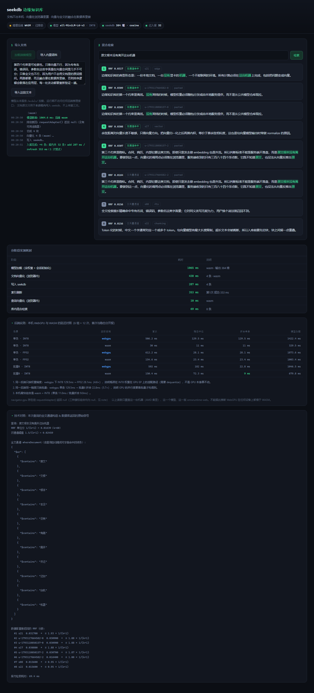

# seekdb 边缘知识库

> 把文档向量化的那一步搬进浏览器，把两路结果的融合留给数据库。
>
> OceanBase AI 生态赛道 · 阶跃星辰题（20 分）交付物。



<sub>截图来自无头 Chromium 实跑，查询「原文根本没有离开这台机器」，k=8 返回 8 条：
前 5 条标记「双通道命中」（RRF 0.0307–0.0317），后 3 条「仅向量通道」（RRF 0.0156–0.0164）。
这个标记是按 RRF 分数是否超过 `1.5/(k+1)` 反推的，**不是数据库直接给的字段**。
后端栏显示「WASM · 已降级」是因为无头模式下 `requestAdapter()` 返回 null。
底部两块折叠区分别是后端矩阵与本次查询的全文通道构造。</sub>

## 它解决什么

一个不能联网、没有独立显卡的机器上，本地文档怎么被搜索到？

常见形态是把文档丢给云端 embedding 接口，再把向量存进某个数据库。这条路在这里走不通：文档不能出本机。
所以本方案把**推理放到用户的浏览器里**（Web Worker + ONNX Runtime Web），
把**向量与全文的融合放到 seekdb 里**（库内 `DBMS_HYBRID_SEARCH`），中间那一层只负责搬数据。

## 快速开始

```bash
npm install --legacy-peer-deps   # seekdb 的 optionalDependencies 用了 workspace:* 协议，必须带这个参数
npm run model                    # 从 ModelScope 拉模型到 models/（约 113 MB）
npm start                        # http://localhost:5173
```

首屏点「加载端侧模型」→「导入内置语料」→ 输入查询。

可选：`npm run bench` 跑量化前后对照（离线，不参与应用运行时路径）。

## 三件技术各自承担什么

| 层 | 承担 | 不承担 |
|---|---|---|
| **浏览器**（Web Worker + Transformers.js） | 模型加载、文档向量化、查询向量化、后端探测与降级 | 不算检索、不排序 |
| **Node 服务**（`server/index.mjs`） | 静态文件、把浏览器算好的向量写进 seekdb、刷新索引、透传一次混合检索调用 | 不做任何推理、不知道模型长什么样 |
| **seekdb** | 向量索引（HNSW 384/cosine）、全文索引（ik 分词）、RRF 融合与排序 | — |

融合完全在库内完成：`server/seekdb.mjs` 里只调了一次 `collection.hybridSearch()`，
没有「分别取两路再拼」的代码路径，也没有这样的接口。

## 目录

```
stepfun/
├── server/
│   ├── index.mjs        # HTTP 服务 + 三个 API
│   └── seekdb.mjs       # 数据层：建集合 / 写入并刷新 / 混合检索 / 全文通道构造
├── web/
│   ├── index.html
│   ├── app.js           # 主线程编排：切块、调接口、渲染读数
│   ├── worker-embed.js  # 端侧推理 Worker（WebGPU → WASM 自动降级）
│   ├── styles.css
│   └── backend-matrix.json  # 后端实测数据（界面「后端实测」面板的数据源）
├── scripts/
│   ├── fetch-model.mjs  # 拉模型（ModelScope 镜像）+ 打印真实字节数
│   └── bench.mjs        # 量化前后质量/速度对照
├── samples/notes.json   # 24 条内置语料
└── models/              # 运行 npm run model 之后才有
```

## 实测读数

单位与口径都写在括号里，**没有估算值**。

**端侧推理**（无头 Chromium / WASM / INT8，同一台机器跑了 3 次完整流程）

| 阶段 | 耗时（3 次区间） | 备注 |
|---|---|---|
| 模型加载 | 826 – 1,666 ms | 差距来自 wasm 模块是否已在同会话缓存、以及当时机器负载 |
| 24 条文档向量化 | 853 – 2,023 ms | 同上 |
| 单条查询向量化 | **7.7 – 7.9 ms** | 稳态，三次几乎无差 |

> 这三次读数不是「挑一个最好看的」：区间两端都是实测。单条查询那 0.2 ms 的差距才是
> 真正稳定的部分 —— 批量操作会被首次预热和系统负载拉出两倍差异，所以给区间不给单点。

**数据库**（24 条语料，同上 3 次）

| 阶段 | 耗时 |
|---|---|
| 写入（add） | 305 – 570 ms |
| 索引刷新（refresh，三次均首次成功） | 235 – 416 ms |
| 库内混合检索 | 6.9 – 25.8 ms（四条查询的实测区间） |

**量化前后**（`npm run bench`，12 条标注查询 × 24 条文档）

| 指标 | FP32 | INT8 |
|---|---|---|
| 权重体积 | 90,387,606 B | 22,972,370 B（**3.935× 更小**） |
| Recall@5 | 0.4167 | 0.375 |
| MRR@5 | 0.4194 | 0.4027 |
| Top5 排序重合度 | — | 0.85 |
| Top1 一致 | — | 9/12 |

**后端**（本机 AMD RDNA-2 集显，每组 12 次）

| 场景 | 实际后端 | 首次 | 稳态中位 |
|---|---|---|---|
| 单条 · INT8 | webgpu | 506.2 ms | 129.5 ms |
| 单条 · INT8 | wasm | 30.0 ms | **11.0 ms** |
| 单条 · FP32 | webgpu | 612.2 ms | 28.1 ms |
| 单条 · FP32 | wasm | 154.6 ms | 23.4 ms |

> 本机上 WASM 反而更快，原因定位为 INT8 权重在 WebGPU EP 上要走 dequantize：
> **同一个 WebGPU 会话**只把权重换成 FP32，延迟就从 129.5 ms 掉到 28.1 ms（4.6×）。
> 这不构成「WebGPU 一定更慢」的结论 —— 只覆盖这台机器、这个模型、这一版 onnxruntime-web。
> 默认策略仍按题意写成「支持时优先 WebGPU」。

## 已知取舍

- **全文通道用 `$contains` 摊成 2-gram**。seekdb 的 `$contains` 是子串匹配而非分词 AND，
  整句查询在任何文档里都不出现，全文通道会恒空、混合检索退化成纯向量。
  摊成 2-gram + `$or` 能救回来，代价是「只要含任意一个词」就算命中，会有噪音
  （实测里 `向量索引写入后为什么查不到` 的 #1 是讲余弦距离的那条，靠「向量」这个词进了全文通道）。
- **all-MiniLM-L6-v2 是纯英文训练**。中文 Recall@5 只有 0.42，这是模型短板不是实现问题；
  也正因为如此，这道题的全文通道不是装饰，它是补中文召回的必要一路。
- **索引刷新要显式调用**。写入后不刷新，向量通道查不到新数据（实测返回 0 条）。
  首次刷新在大批量下可能撞内部超时 `ret=-4012`，所以 `refreshWithRetry` 会重试并回报每次尝试的真实耗时。

## 合规

- 向量只在浏览器 Worker 里算，服务端只接收算好的数组（`server/seekdb.mjs` 里没有任何推理调用）。
- 检索只调一次 `hybridSearch()`，不在客户端分别取两路结果再拼。
- 运行期不访问任何远端推理接口：`env.allowRemoteModels = false`，模型全部来自本机 `/models/`。
